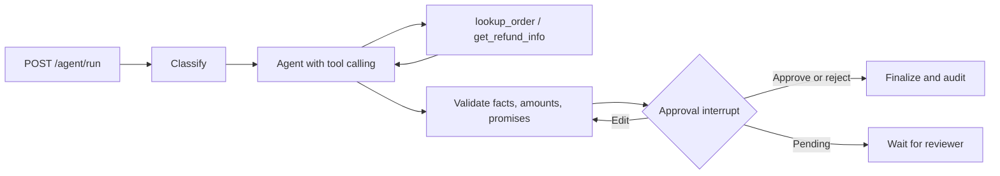

# FlowPilot AI

FlowPilot AI is a local customer-support workflow demo. It classifies a
fictional customer message, looks up sample order/refund/payment facts, drafts
a response, and blocks further workflow progress until a human explicitly
approves it. The original deterministic workflow remains available alongside
a tool-using LangGraph agent with an interruptible review step.

It does **not** send customer messages, issue refunds, process payments, or
change orders. Order/refund/payment lookup functions read existing facts;
database initialization only creates missing local sample data or schema.

## Setup

Use Python 3.10 or newer. Install runtime dependencies:

```text
python -m pip install -r requirements.txt
```

For development, tests, coverage, and lint:

```text
python -m pip install -r requirements-dev.txt
```

The application reads configuration from process environment variables. It
does not automatically load `.env`; `.env.example` contains placeholders and
defaults only. Never commit a real `.env` or paste a credential into shell
history.

## CLI

Run the local sample demo:

```text
python flowpilot.py
```

Run a message through a specific response mode:

```text
python flowpilot.py --mode template --message "My order ORD1042 has not arrived."
python flowpilot.py --mode mock --message "My order ORD1042 has not arrived."
python flowpilot.py --mode openai --message "My order ORD1042 has not arrived."
```

Template mode is the default. Mock mode is offline. OpenAI mode requires
`OPENAI_API_KEY` and can send request content to OpenAI; use it only when that
data transfer is approved. `OPENAI_MODEL` is optional and defaults to
`gpt-4o-mini`. The legacy positional-message form and `--llm` alias remain
supported. Add `--db PATH` to select a local SQLite file and `--json` to export
the result to `workflow_result.json`.

Every interactive CLI response requires a human decision. Without a reviewer
decision, the result stays Pending and cannot proceed.

Run the built-in classifier checks:

```text
python flowpilot.py --classify-tests
```

Run the offline labelled evaluation:

```text
python scripts/evaluate.py --mode template
python scripts/evaluate.py --mode mock
```

The evaluator uses fictional cases and a temporary SQLite database. It never
calls OpenAI or requests human approval. See
[docs/EVALUATION.md](docs/EVALUATION.md) for the latest measured results.

Run the LangGraph evaluation and write JSON/Markdown reports:

```text
python run_eval.py --mode mock
python run_eval.py --mode mock --limit 10 --output reports
```

Live evaluation requires a user-provided `OPENAI_API_KEY` and explicit consent:

```text
python run_eval.py --mode live --live --limit 5
```

Without `--limit`, live mode evaluates at most five cases. Setting
`LLM_MODE=live` also explicitly enables live evaluation; `--mode mock` always
stays offline. Configure `FLOWPILOT_EVAL_MIN_ACCURACY` and
`FLOWPILOT_EVAL_SLOW_THRESHOLD_MS` to change the CI accuracy gate and slow-run
threshold. Evaluation reports are written under `reports/` and compare against
an existing `eval_report.json` in the output directory.

## Policy lookup (RAG)

General Inquiry replies can use local fictional Markdown policies in `kb/`.
The retriever is pure Python (BM25), makes no network or embedding calls, and
adds source titles to the reply. Policy passages are treated as data; unsupported
numbers and promises are rejected, and a human still makes every final decision.
If no passage is found, the existing General Inquiry template is used.

The authenticated, read-only `GET /kb/search?q=...` endpoint returns up to
three passages and requires `X-Review-API-Key`. The `/process` route is an alias
for `/workflow`; both keep generated responses Pending. See
[docs/KNOWLEDGE_BASE.md](docs/KNOWLEDGE_BASE.md) for document and evaluation
guidance.

## FastAPI and Streamlit

Configure `REVIEW_API_KEY` securely in the API process, then start the API on
loopback:

```text
uvicorn api:app --host 127.0.0.1 --port 8000
```

In another terminal, launch the UI:

```text
streamlit run ui.py
```

The UI talks to the API over HTTP. It defaults to
`http://127.0.0.1:8000`; set `FLOWPILOT_API_URL` if the local API uses another
address. OpenAI mode requires a separate billable-request confirmation in the
UI. The reviewer enters the API's configured `REVIEW_API_KEY` to approve or
reject a pending response; the key is entered in a password field in the
sidebar. The Evaluation and Review stats tabs use the same key to read
`GET /evaluation` and `GET /stats`. Set `EVALUATION_RESULTS_PATH` in the API
process to serve an evaluation report from a different path; by default it
reads `evals/results.json`. Review stats report category counts only if the
approval audit table contains a category column.

Keep both services on loopback for local demonstration. The generation API
and n8n webhook are not a production authentication boundary.

## LangGraph agent

The agent reuses the established classifier and invokes only read-only order
and refund tools. Refund lookup first verifies that the supplied fictional
customer ID owns the order. The graph validates the draft against tool facts,
then pauses at a LangGraph interrupt. No message is sent and no refund or
order is changed, even after approval.



Example request (customer ID is fictional):

```json
{
  "message": "Please check refund ORD7391.",
  "customer_id": "CUST1007",
  "mode": "mock"
}
```

Agent endpoints:

- `POST /agent/run`: start an agent run; `mode` is `mock` by default or
  `live` for an explicitly selected OpenAI request.
- `GET /agent/runs/{run_id}`: view the draft, tool results, validation flags,
  and metrics; requires `X-Review-API-Key`.
- `POST /agent/runs/{run_id}/approve`: approve with `{"action":"approve"}` or
  submit an edit with `{"action":"edit","draft_reply":"..."}`. Edits are
  revalidated and pause for review again.
- `POST /agent/runs/{run_id}/reject`: reject; requires the reviewer key.
- `GET /metrics/summary`: aggregate run latency, token, and configured cost
  measurements; requires the reviewer key.

Mock is the default and reports zero tokens and zero cost. Live agent calls
require `OPENAI_API_KEY`; configure `OPENAI_PRICE_INPUT_PER_1M` and
`OPENAI_PRICE_OUTPUT_PER_1M` for an estimated cost. If live pricing is not
configured, cost is reported as unavailable. `REFUND_WINDOW_DAYS`,
`NON_REFUNDABLE_CATEGORIES`, and the optional `REFUND_AS_OF_DATE` configure
the fictional refund policy.

Pending runs use LangGraph's in-memory checkpointer and the API's in-process
run registry. A process restart loses unresolved agent runs; approved/rejected
decisions and run metrics are stored in SQLite.

## Integrations and manual OpenAI verification

- Importable, inactive n8n export: [docs/n8n-integration.md](docs/n8n-integration.md)
- Manual-only live OpenAI procedure: [docs/openai-verification.md](docs/openai-verification.md)

Live OpenAI verification is **UNVERIFIED** and requires a user-provided key.
Automated checks never make paid OpenAI calls. Do not run the manual verifier
unless you intentionally want to send one billable request.

## Evaluation and failure analysis

The generated [mock agent report](reports/eval_report.md) and its
[JSON data](reports/eval_report.json) are measured outputs of the local
97-case synthetic evaluation. Mock-mode category accuracy is not LLM accuracy
or real-world accuracy. Use `run_eval.py` to regenerate the report after
changing the agent.

Real/live result fields are intentionally left for a user-run, authorized
evaluation:

- Live model and date: **[fill from an actual live run]**
- Live cases and accuracy per category: **[fill from `reports/eval_report.json`]**
- Live p50/p95 latency and token totals: **[fill from the report]**
- Configured prices and estimated cost: **[fill from the report; do not infer]**
- Failure cases, reason codes, and fixes: **[fill using
  `docs/FAILURE_REPORT_TEMPLATE.md`]**

Do not replace these placeholders with estimates or mock results.

## Limitations

- Every included order, customer, message, and policy is synthetic; this small
  local dataset is not evidence of production behavior.
- The mock provider is deterministic and offline. Its measured classification
  score does not establish real-world model accuracy or safe behavior.
- Fact and promise checks are defensive heuristics, not semantic proofs.
- Pending LangGraph checkpoints and run objects are in memory and do not
  survive a server restart.
- The demo has no production identity system, rate limiting, encrypted database,
  durable review queue, or capability to execute refunds or send replies.

## Developer checks

```text
python -m unittest -v
python flowpilot.py --classify-tests
python scripts/evaluate.py
python run_eval.py --mode mock
ruff check .
coverage run -m unittest discover -v
coverage report --fail-under=65
python scripts/check_secrets.py
```

See [docs/ARCHITECTURE.md](docs/ARCHITECTURE.md),
[docs/TESTING.md](docs/TESTING.md), and
[docs/SECURITY.md](docs/SECURITY.md) for design, validation, and deployment
limitations.
