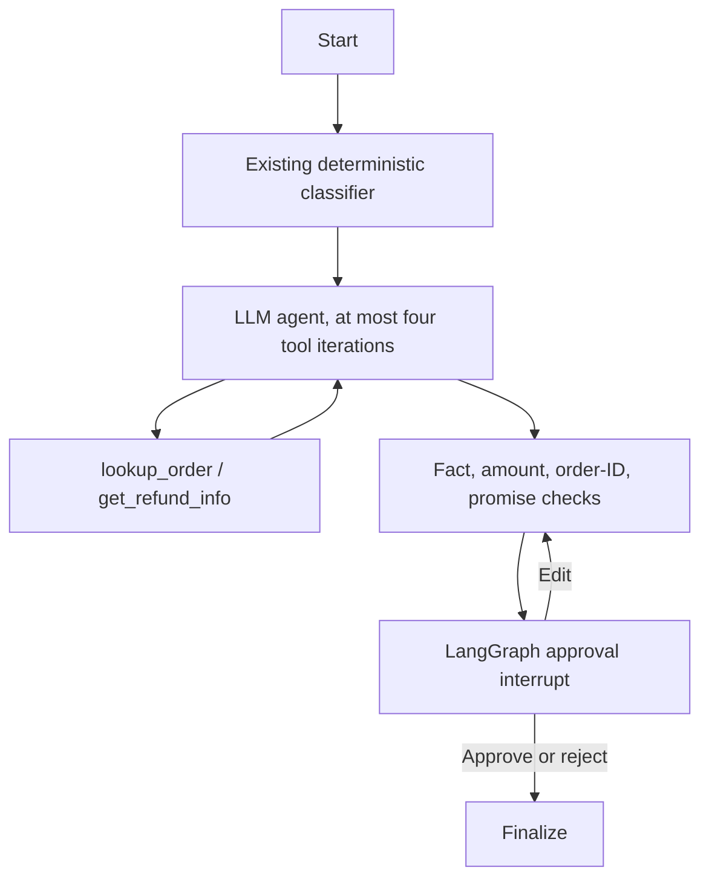

# Architecture

## Request and response flow

```text
CLI ─────────────────────────┐
Streamlit UI -> FastAPI      ├─> classify/validate -> one SQLite lookup
n8n -> FastAPI               │       -> General Inquiry policy retrieval
                             │       -> template or selected provider
                             │       -> factual/policy validation -> fallback
                             └───────> Pending response -> explicit human review
                                                       -> SQLite approval audit
```

The interfaces call the same workflow functions rather than reimplementing
classification or data access:

1. `flowpilot.py` normalizes and classifies the customer message.
2. The workflow extracts a supported order ID and performs at most one relevant
   lookup. The result dictionary is reused for response generation.
3. Only General Inquiry searches the local policy folder. Template mode cites
   the top passage; mock and OpenAI modes receive delimited passages as
   untrusted data. Other categories do not use the policy index.
4. Provider candidates are checked against workflow facts and, for General
   Inquiry, policy numbers and promises are checked against retrieved text.
   Missing passages, provider errors, empty text, and rejected claims use the
   existing template response.
5. CLI review, the FastAPI review endpoint, or Streamlit can record a decision.
   Generation alone always leaves `approval_status` Pending and
   `can_proceed` false.

`flowpilot.py` imports the template generator; the template generator may
optionally import the LLM provider. The LLM module imports template helpers
only inside its fallback function, after module initialization. This avoids an
import-time cycle; the reload-and-fallback regression test exercises that path.
Provider-assisted workflow reuses the already-fetched result instead of
performing a second database lookup.

## Provider and prompt boundaries

`OpenAIProvider` uses the official OpenAI Python SDK. Its API key and model are
read from `OPENAI_API_KEY` and `OPENAI_MODEL`; credentials are not included in
prompts or log output. The prompt separates system instructions from the
customer/context message. Customer content is untrusted input and cannot
override system rules.

The model only drafts text. It has no database write interface or tools for
issuing refunds, changing orders, or processing payments. Regex-based factual
and policy validation are defensive filters, not semantic proofs. Retrieved
passages and customer messages are data, never instructions. Mandatory human
review remains in place.

`GET /kb/search?q=...` requires the configured reviewer key, limits queries to
200 characters, and returns at most three local passages without modifying
data. `/process` and the existing `/workflow` endpoint return the same Pending
workflow result.

## SQLite and audit records

`database.py` stores fictional sample orders and the `approval_logs` table.
Existing order/refund/payment facts are not rewritten during initialization or
lookups. Missing local tables and fixture records can be created as part of
database initialization.

Approval decisions are append-only under ordinary SQL operations: SQLite
triggers reject updates and deletes to `approval_logs`. A privileged operator
can still alter the database schema or remove the triggers, so this is not a
tamper-proof external audit service.

The API keeps unreviewed response payloads in process memory. A restart loses
pending items; completed review decisions persist in SQLite. This is suitable
for a local demo, not a durable queue.

## API security boundary

The API is intended to bind to `127.0.0.1`. Review decisions require a
configured `REVIEW_API_KEY` and a matching `X-Review-API-Key` header. The key
is compared in constant time and is never returned in API errors. The review
route accepts only Approved or Rejected decisions and writes through the
existing approval audit function.

Generation is not authenticated, and the sample n8n webhook is also
unauthenticated. Do not expose either service outside a trusted local
environment without adding authentication, TLS, rate limits, and deployment
controls.

## LangGraph agent path

The original `/workflow` and `/process` paths are unchanged. The separate
`/agent/run` path builds this typed graph:



The OpenAI provider uses the official SDK function-call interface. `MockLLM`
uses the same interface, can be scripted for tests, and automatically exercises
the read-only order/refund tools for local demos. A refund-info request is
preceded by an order ownership check using the run's customer ID; mismatches do
not return another customer's order details. Tool arguments are JSON-validated
and each accepted or rejected tool request is logged with its status and
duration.

The approval gate interrupts every agent run. An edit returns through
validation and interrupts again; approval or rejection is recorded through the
existing append-only approval audit. Approval only marks the draft as
reviewed: there is no message-sending or refund execution node. Runs and
checkpoints are process-local; a restart loses unresolved runs.

`GET /agent/runs/{id}` and reviewer decisions require `REVIEW_API_KEY`.
`POST /agent/run` follows the pre-existing unauthenticated workflow-generation
pattern and accepts a caller-supplied fictional customer ID. That ID is not an
identity credential, so keep the service on loopback and do not use real
customer data.

## Metrics and evaluation

`metrics.py` stores one upserted row per agent run in `run_metrics`, excluding
the message and draft text. The record includes model/mode, node and total
latencies, LLM latency, token counts, tool calls, and cost when both configured
prices are available. Mock costs and tokens are zero; live costs are unknown
until `OPENAI_PRICE_INPUT_PER_1M` and `OPENAI_PRICE_OUTPUT_PER_1M` are supplied.
The authenticated `/metrics/summary` route computes latency percentiles and
token/cost totals from those rows.

`run_eval.py` runs the separate 97-case JSONL agent set in a temporary SQLite
database. Mock is the default and makes no network call. Live mode requires
`OPENAI_API_KEY` and explicit `--live` authorization or `LLM_MODE=live`; absent
an explicit limit it runs at most five cases. Reports include category
accuracy, reason-coded failures, measured latency/token/cost fields, and a
comparison to the prior report in the chosen output directory. The fixed
`FLOWPILOT_EVAL_REFERENCE_DATE` (default `2026-11-13`) makes the fictional
refund-window evaluation repeatable; the interactive app uses the current date
unless `REFUND_AS_OF_DATE` is set.
